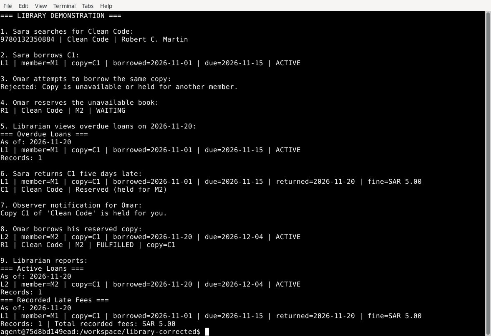
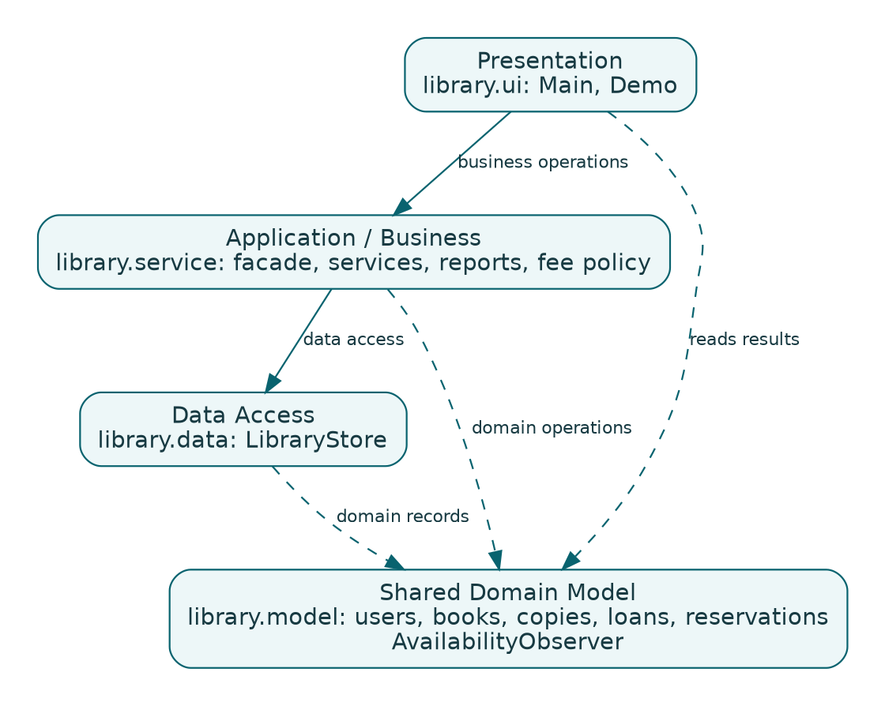

# Automated Library Management System

A Java 17 console application for exploring object-oriented design and library circulation workflows. It supports member and librarian roles, physical book copies, loans, FIFO reservations, availability notifications, late fees, and reports.

This is an educational project with a layered structure inside a single JVM. It uses in-memory data and has no external runtime dependencies.

## Quick start

Install **JDK 17 or newer**. A JRE alone cannot compile the project.

Windows Command Prompt:

```bat
run.bat
run.bat --demo
test.bat
```

Linux / macOS:

```sh
bash run.sh
bash run.sh --demo
bash test.sh
```

In an IDE, mark `src` as the source root, choose JDK 17+, and run `library.ui.Main`. Pass `--demo` for the repeatable demonstration. Tests use `library.LibraryTests` under `test`.

## Demonstration



The demo walks through searching, borrowing, rejecting an already borrowed copy, placing a reservation, returning five days late, recording a SAR 5 fee, notifying the next member, and collecting the held copy. It uses fixed dates for repeatable output.

[Read the complete sample output](docs/example-output.txt).

## Features

- Case-insensitive partial search by title, author, or ISBN.
- Separate bibliographic records and physical book copies.
- Librarian-only catalog editing and loan/fee reports.
- Member borrowing, returns, reservations, and notification inboxes.
- A 14-day loan period and at most three active loans per member.
- No two active loans of the same title for the same member.
- FIFO reservations: a returned or newly added copy is held for the first waiting member.
- Late fee strategy with a default rate of SAR 1 per day after the due date.

The loan limits and fee rate are example domain rules.

## Demo accounts

| ID | Password | Role |
| --- | --- | --- |
| A1 | admin123 | Librarian |
| M1 | member123 | Sara, member |
| M2 | member123 | Omar, member |
| M3 | member123 | Lina, member |

These are fictional, hardcoded demo accounts, not production credentials. Members can return only their own loans; librarian operations are checked at the facade. Restarting the application resets all records.

## Architecture

```text
Single Java application / JVM
  Presentation: Main, Demo
        |
        v
  Business: LibraryFacade
        -> CatalogService / LoanService / ReservationService / Reports
        |
        v
  Data: LibraryStore (in-memory)

  Shared domain: Book, BookCopy, User, Loan, Reservation
```

The application combines a **monolithic deployment** with a **layered internal structure**. These are compatible views of the same application.



## Implemented design patterns

| Pattern | Implementation | Purpose |
| --- | --- | --- |
| State | `BookCopy.CopyState` and its available, checked-out and reserved states | Control permitted copy transitions |
| Strategy | `FineCalculationStrategy`, injected into `LoanService` | Replace the late-fee policy |
| Observer | `AvailabilityObserver`, `Member`, `ReservationService` | Notify the next member when a copy is held |
| Facade | `LibraryFacade` | Present a single entry point for console operations |
| Factory Method | `Reports.ReportCreator` subclasses | Create the appropriate report product |
| Template Method | `Reports.Report.generate()` | Fix the report workflow while varying row selection, title and footer |

Overdue status is derived from loan dates; it is not a physical-copy state. Diagram images and editable Graphviz sources are in [docs/uml](docs/uml).

## Verification

`test.bat` / `bash test.sh` compile source and run **48 dependency-free checks** covering role restrictions, search, due dates, limits, return ownership, FIFO allocation, notifications, fee boundaries, copy states, failed-operation consistency, and report totals.

The GitHub Actions workflow runs the checks and demonstration on Java 17. A local review compiled with `--release 17` and passed all 48 checks; the hosted CI result is separate and will appear after a push.

## Scope and limitations

- Console interface; no web UI or API.
- In-memory records; no database or disk persistence.
- Single-user console execution; services and storage are not thread-safe. Sequential duplicate-loan rejection is not a concurrency guarantee.
- Hardcoded demo passwords; no production authentication or password hashing.
- Reservations remain held until collected; cancellation and expiration are not implemented.
- Return dates can be simulated for the demonstration.
- Reports classify current stored records using the selected date; they do not reconstruct historical snapshots. Fee totals are recorded charges, not payment collection.
- Returned domain objects are mutable; a future external API should use DTOs and tighter mutation boundaries.

## Project layout

```text
src/library/
  model/       Domain entities, copy states and observer contract
  data/        In-memory store
  service/     Catalog, lending, reservations, fees and reports
  ui/          Console menus and deterministic demo
test/library/  Integration checks
docs/          UML diagrams, screenshots and sample output
.github/       Continuous integration
```

## Background and next steps

The project originated as a collaborative software design and architecture course project. Source comments retain the original work-allocation notes. The public repository focuses on implementation and design documentation; submission reports and student-ID fields are omitted.

Useful next steps are persistent storage, JUnit tests with a build tool, reservation cancellation/expiration, immutable API responses, and transaction-safe lending before adding concurrent clients.
